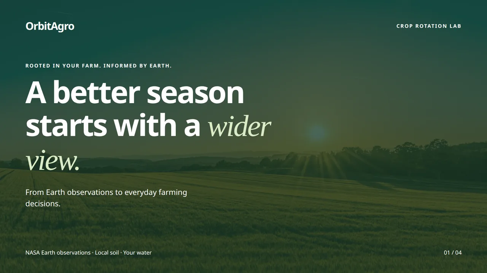
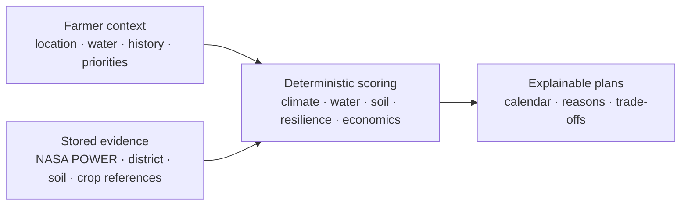
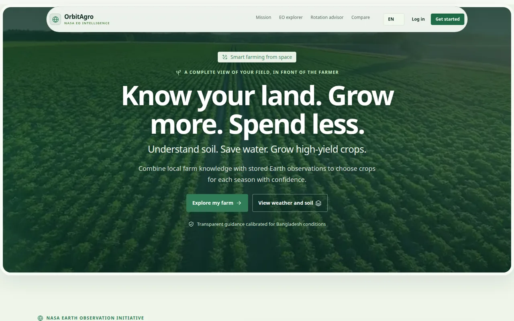
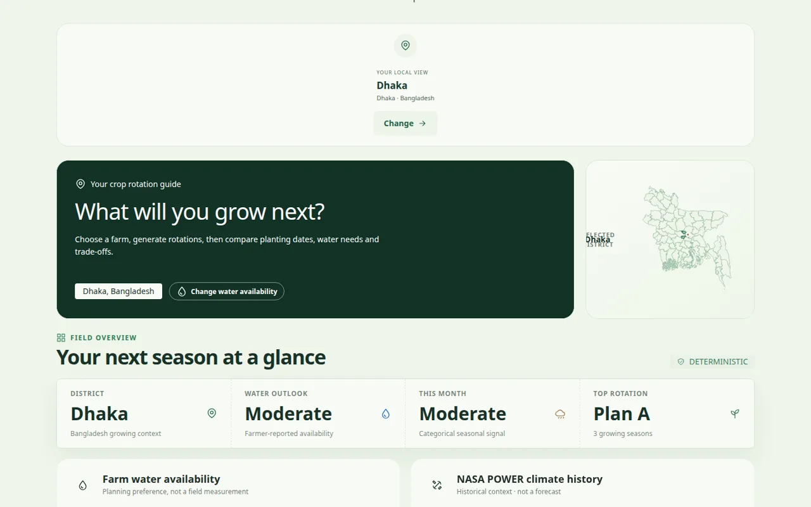
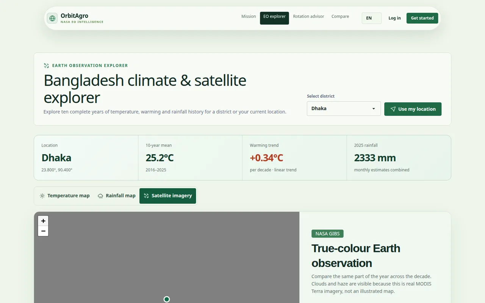

# OrbitAgro

**Understand your land. Adapt your farming. Grow resilience.**

OrbitAgro is a crop-rotation decision-support application for farmers in Bangladesh. It combines cached NASA POWER climate context, district and soil references, reviewed crop guidance, and farmer priorities to produce explainable seasonal options with a deterministic scoring engine.

[](docs/readme/orbitagro-demo.mp4)

**[Watch the 20-second product tour](docs/readme/orbitagro-demo.mp4)** · Sample interface and seasonal plan; not planting advice.

## Our mission

Farmers make seasonal decisions while rainfall patterns, dry-season water pressure, soil condition, and input costs keep changing. Useful evidence exists, but it is often difficult to connect with the reality of one field.

OrbitAgro turns that evidence into a practical conversation:

- start with the farmer's district, water access, field history, and priorities;
- explain which climate, soil, water, and transition rules were checked;
- compare rotations instead of presenting one unexplained answer;
- keep missing measurements unknown instead of inventing precision;
- leave the final decision with the farmer.

The MVP is calibrated around a one-hectare Bogura scenario and designed first for low-to-mid-range Android phones, outdoor use, and slow connections.

## How OrbitAgro works



The same inputs always produce the same result. Recommendation generation never calls NASA or an LLM: it reads cached environmental profiles and reviewed reference data. If required evidence is missing or stale, OrbitAgro reports that limitation instead of fabricating a recommendation.

## NASA data used

These are the NASA datasets used by the working demo. The first dataset supplies planning inputs; the second is a contextual map layer only.

| Dataset | Official link | How OrbitAgro uses it |
|---|---|---|
| **NASA POWER Agroclimatology daily and monthly data** | [NASA POWER Temporal APIs](https://power.larc.nasa.gov/docs/services/api/temporal/) · [Daily API](https://power.larc.nasa.gov/docs/services/api/temporal/daily/) · [Monthly API](https://power.larc.nasa.gov/docs/services/api/temporal/monthly/) | The app requests the latest ten complete years for a farm point and for the Bangladesh explorer. Daily parameters are 2 m mean/minimum/maximum air temperature (`T2M`, `T2M_MIN`, `T2M_MAX`), corrected precipitation (`PRECTOTCORR`), 2 m relative humidity (`RH2M`), all-sky surface shortwave radiation (`ALLSKY_SFC_SW_DWN`), and 10 m wind speed (`WS10M`). Stored daily observations are converted into deterministic seasonal rainfall, dry-spell, heavy-rain, temperature, and coverage features used to screen crop rotations. Monthly `T2M`, `T2M_MAX`, and `PRECTOTCORR` values power the climate-history charts and regional temperature/rainfall map. These are historical grid estimates, not field measurements or forecasts. |
| **MODIS Terra Corrected Reflectance True Color** via NASA EOSDIS GIBS | [GIBS layer](https://gibs.earthdata.nasa.gov/wmts/epsg3857/best/MODIS_Terra_CorrectedReflectance_TrueColor/) | The explorer loads dated true-colour satellite tiles as visual context for the selected month. The imagery is not analyzed, does not produce vegetation or crop-stress indices, and does not affect recommendation scores. |

NASA POWER responses are cached before scoring so a recommendation remains reproducible if the API is unavailable. The scoring engine never makes a live NASA request while calculating a recommendation.

### NASA imagery used for presentation only

The homepage also contains optimized copies of five NASA Earth Observatory images. They explain the kinds of Earth observations relevant to farming but are not data inputs to the planner or scoring engine.

| Image source | How it is used |
|---|---|
| [Fine-Tuning Irrigation in Asia](https://science.nasa.gov/earth/earth-observatory/fine-tuning-irrigation-in-asia-148203/) | Illustrates thermal observation and irrigation context in Bangladesh. |
| [Excessive Monsoon Rains Flood Asia](https://science.nasa.gov/earth/earth-observatory/excessive-monsoon-rains-flood-asia-147006/) | Illustrates monsoon rainfall and flooding context. |
| [Food Crisis Grows from Dry Soils](https://earthobservatory.nasa.gov/images/145116/food-crisis-grows-from-dry-soils) | Illustrates soil-moisture context. |
| [World of Change: Global Temperatures](https://earthobservatory.nasa.gov/world-of-change/global-temperatures) | Illustrates long-term temperature change. |
| [NASA Data Aid Food Security Assessments in Kenya](https://earthobservatory.nasa.gov/images/147831/nasa-data-aid-food-security-assessments-in-kenya) | Illustrates vegetation monitoring and food-security context. |

## Product experience

### A field-first starting point



### Transparent seasonal planning



### Earth-observation context



Planner and explorer screenshots use the repository's non-persistent browser-test fixtures so the interface can be demonstrated without claiming personalized agronomic results.

## Visual design and motion

OrbitAgro uses visuals to explain the path from Earth observation to a farm decision, not as decoration alone.

- Local field footage & NASA Earth Observatory imagery establish the wider environmental context.
- Animated climate layers, seasonal charts, crop calendars, map controls, and restrained transitions reveal change over time.
- Motion pauses when the user requests reduced motion; the homepage video is also disabled for data-saving connections.
- Posters, local media, lazy-loaded imagery, and mobile layouts keep the experience usable on slower devices.
- English and Bangla controls, keyboard-accessible interactions, text alternatives, and explicit missing-data states keep the interface understandable.

## What is included

- Three-season crop-rotation planning with planting and harvest windows
- Farmer-defined priorities for climate, water, soil, resilience, and economics
- District climate history and Earth-observation exploration
- Saved farms, crop history, soil observations, and environmental profiles
- Side-by-side rotation comparison with reasons and trade-offs
- Optional integrated farming evidence screening
- Location detection with a manual district fallback
- Downloadable planting guidance and saved rotation choices

## Install and run

### Requirements

- Git
- Docker with Compose
- Python 3

### Easy installation (recommended)

Clone the project, enter its directory, and run the setup script:

```bash
git clone https://github.com/km-wahid/NasaSpaceAppsChallange.git
cd NasaSpaceAppsChallange
./setup.sh
```

Open [http://localhost:3333](http://localhost:3333) when the script finishes.

`setup.sh` validates and prepares the included Bangladesh crop dataset, builds the application, starts PostgreSQL, runs migrations and seeders, imports the dataset into a fresh database, and waits until the website is ready. Running it again preserves existing farmer data.

### Alternative: manual installation

If you prefer to run each setup step yourself:

```bash
python3 database/prepare_import.py
docker compose -f docker.yml up -d --build
docker compose -f docker.yml exec -T postgres \
  psql -v ON_ERROR_STOP=1 -U nasaweb -d nasaweb -f /imports/load_postgres.sql
docker compose -f docker.yml restart app
```

Then open [http://localhost:3333](http://localhost:3333).

### Production build

To build the application directly from source:

```bash
cd app
npm install
npm run build
```

To build only the Docker image without starting the containers:

```bash
docker compose -f docker.yml build
```

```bash
# Follow application logs
docker compose -f docker.yml logs -f app

# Stop the application while keeping PostgreSQL data
docker compose -f docker.yml down
```

Only add `-v` to the final command when you intentionally want to delete the PostgreSQL volume.

## Development

The application source and npm commands live in `app/`.

```bash
cd app
npm install
npm run dev
```

Direct development requires a PostgreSQL 16 database matching `app/.env`. See the [application development guide](app/README.md) for environment setup, migrations, data loading, endpoints, and troubleshooting.

Before submitting a change:

```bash
cd app
npm run lint
npm run typecheck
npm test
npm run build
```

With a running application, `npm run test:site` exercises direct routes, responsive layouts, location fallbacks, planner wiring, comparison views, authentication guards, and reduced-motion behavior using local fixtures.

## Architecture

| Layer | Technology | Responsibility |
|---|---|---|
| Backend | AdonisJS 7, TypeScript, VineJS | Validation, authentication, controllers, and services |
| Frontend | React 19, Inertia.js | Farmer workflows and server-driven navigation |
| UI | Tailwind CSS 4, daisyUI 5, custom CSS | Responsive components, maps, charts, and motion |
| Data | PostgreSQL 16, Lucid ORM | Farms, references, cached profiles, and recommendation snapshots |
| Maps | Leaflet, OpenStreetMap | District and environmental context |
| Runtime | Docker Compose | Reproducible application and database services |

Core business rules live in `app/app/services/`. Controllers validate requests and delegate to those services; scoring never performs network calls or random work.

## Data, privacy, and limits

- Dataset successfully published on Mendeley Data: : https://data.mendeley.com/datasets/tb5x9gw2pt/2
- NASA POWER and NASA GIBS provide environmental context; NASA does not endorse the application.
- OpenStreetMap data and Nominatim support maps and user-triggered reverse geocoding.
- Location detection runs only after a user action. Guests are not persisted; signed-in users can save a district preference.
- Public Nominatim is rate-limited, cached, and treated as an unavailable dependency when it fails.
- Regional climate and soil references are not substitutes for field measurements.
- Profit comparisons, suitability claims, and integrated systems are shown only when their required evidence is complete.

See [crop reference documentation](docs/crop_references.md), the in-app **Sources** page, and [media provenance](app/public/media/README.md) for details.

## Repository map

```text
app/                 AdonisJS, React/Inertia, services, migrations, and tests
database/            Source-data preparation and PostgreSQL import
docs/                Crop references and README media
scripts/             Dataset analysis and reporting helpers
brag-output/         HyperFrames launch-film source
docker.yml           Complete application stack
setup.sh             Fresh-clone setup
```

OrbitAgro is decision support, not a forecast or a replacement for local agronomic advice.
